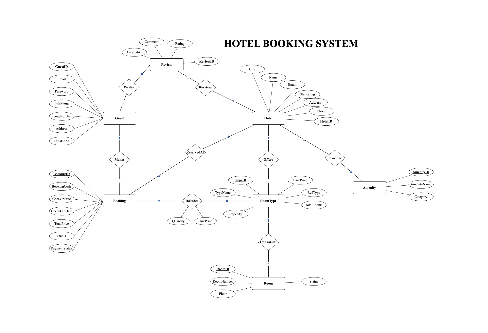

# BÁO CÁO BÀI TẬP TUẦN 5 | Thiết kế Dữ liệu, Tài nguyên & Chiến lược Phân trang

## PHẦN 1: THIẾT KẾ TÀI NGUYÊN (Hệ thống Quản lý Đặt phòng Khách sạn)

### 1. Phân tích Nghiệp vụ & Lựa chọn Domain
Hệ thống Hotel Booking được thiết kế nhằm phục vụ các luồng tác vụ từ tra cứu, đặt phòng đến quản lý đánh giá khách hàng. Các tài nguyên cốt lõi trong hệ thống bao gồm:
- **Hotel (Khách sạn):** Chứa thông tin định danh, tên, địa chỉ, hạng sao (1–5), thông tin liên hệ và các tiện ích đi kèm.
- **Room type & Room (Loại phòng & Phòng):** Quản lý các hạng phòng (Standard, Deluxe, Suite,...) và danh sách các phòng vật lý tương ứng của từng khách sạn.
- **Booking (Đơn đặt phòng):** Tài nguyên độc lập (First-class resource) quản lý vòng đời đặt phòng (từ `pending` -> `confirmed` -> `checked_in` -> `completed` / `cancelled`), liên kết chặt chẽ với khách sạn và người dùng.
- **Booking Detail (Chi tiết Đơn):** Bảng trung gian nhằm lưu lại "ảnh chụp" (snapshot) về đơn giá, số lượng phòng và số đêm tại thời điểm chốt đơn.
- **Review (Đánh giá):** Hệ thống ghi nhận phản hồi và chấm điểm trải nghiệm (1–5 sao) từ khách hàng.
- **Amenity & HotelAmenity:** Quản lý danh mục các tiện ích chung và ánh xạ tiện ích cụ thể cho từng khách sạn.

---

### 2. Mô hình Thực thể Quan hệ (ERD) & Ánh xạ API

*Bảng phân tích bản số (Cardinality) và Quy tắc ánh xạ API:*

| Cặp thực thể | Bản số | Phân loại quan hệ | Chiến lược Ánh xạ API (Dựa theo Slide 12) |
| :--- | :---: | :---: | :--- |
| HOTELS – ROOM_TYPES | 1 : N | Composition (Mạnh) | Sub-resource lồng nhau: `/hotels/{id}/room-types` |
| ROOM_TYPES – ROOMS | 1 : N | Composition (Mạnh) | Sub-resource lồng nhau: `/hotels/{id}/rooms` |
| USERS – BOOKINGS | 1 : N | Association (Yếu) | Dùng Top-level kết hợp filter: `/bookings?user_id=...` |
| BOOKINGS – DETAILS | 1 : N | Composition (Mạnh) | Sub-resource: `/bookings/{id}/items` |
| ROOM_TYPES – DETAILS | 1 : N | Association | Bảng trung gian (Junction) lưu trữ metadata |
| HOTELS – REVIEWS | 1 : N | Strong Containment | Sub-resource lồng nhau: `/hotels/{id}/reviews` |
| HOTELS – AMENITIES | N : M | Many-to-Many | Cặp Endpoint liên kết: `/hotels/{id}/amenities` |

---

### 3. Thiết kế URL Endpoints (18 Endpoints)
Danh sách API tuân thủ nghiêm ngặt các tiêu chuẩn RESTful: dùng danh từ số nhiều, sử dụng đúng chuẩn HTTP Method thay cho động từ trong URL, giữ độ sâu URL tối đa ở 2 cấp và ẩn đi cấu trúc database.

| STT | HTTP Method | URL Endpoint | Mô tả chi tiết nghiệp vụ & Pattern áp dụng |
| :-: | :--- | :--- | :--- |
| 1 | `GET` | `/hotels` | Lấy danh sách khách sạn (Top-level). Có hỗ trợ phân trang & bộ lọc (`city`, `star_rating`, `price_min`, `price_max`). |
| 2 | `POST` | `/hotels` | Tạo mới khách sạn (Payload được validate qua JSON Schema). |
| 3 | `GET` | `/hotels/{hotelId}` | Xem chi tiết thông tin của một khách sạn. |
| 4 | `PUT` | `/hotels/{hotelId}` | Cập nhật toàn bộ thông tin khách sạn. |
| 5 | `DELETE` | `/hotels/{hotelId}` | Xóa khách sạn (trả về mã 204 No Content). |
| 6 | `GET` | `/hotels/{hotelId}/room-types` | Lấy danh sách loại phòng của khách sạn (Nested Pattern A). |
| 7 | `POST` | `/hotels/{hotelId}/room-types` | Thêm loại phòng mới vào khách sạn tương ứng. |
| 8 | `GET` | `/hotels/{hotelId}/rooms` | Xem danh sách phòng vật lý (hỗ trợ filter `?status=available`). |
| 9 | `GET` | `/hotels/{hotelId}/reviews` | Xem các đánh giá về khách sạn (Nested sub-resource). |
| 10 | `POST` | `/hotels/{hotelId}/reviews` | Đăng bài đánh giá & chấm sao cho khách sạn. |
| 11 | `GET` | `/hotels/{hotelId}/amenities` | Lấy danh sách tiện ích hiện có tại khách sạn (Junction N:M). |
| 12 | `POST` | `/hotels/{hotelId}/amenities` | Gán một tiện ích mới cho khách sạn. |
| 13 | `GET` | `/bookings` | Truy xuất đơn đặt phòng (Top-level Pattern B, lọc đa chiều). |
| 14 | `POST` | `/bookings` | Khởi tạo đơn đặt phòng mới (First-class resource độc lập). |
| 15 | `GET` | `/bookings/{bookingId}` | Xem chi tiết phòng đã đặt và trạng thái thanh toán của đơn. |
| 16 | `PATCH` | `/bookings/{bookingId}` | Cập nhật trạng thái hoặc hủy đơn (thay vì dùng endpoint `/cancelBooking`). |
| 17 | `GET` | `/users/{userId}/bookings` | Lấy lịch sử đặt phòng của một tài khoản khách hàng. |
| 18 | `GET` | `/amenities` | Truy xuất danh mục toàn bộ các tiện ích dùng chung của hệ thống. |

---

### 4. Đặc tả JSON Schemas
Toàn bộ schema đã được định nghĩa chặt chẽ và vượt qua 100% các bài kiểm thử hợp lệ bằng thư viện `jsonschema` của Python (lưu tại thư mục [`schemas/`](./schemas/)):
1. [`schemas/hotel.json`](./schemas/hotel.json): Quy chuẩn dữ liệu Khách sạn (cấu trúc giá tiền, định dạng thời gian ISO 8601 và nhúng tóm tắt các tiện ích).
2. [`schemas/booking.json`](./schemas/booking.json): Quy chuẩn Đơn đặt phòng (nhúng thông tin khách hàng, chi tiết thanh toán và định nghĩa mảng `items` qua `$defs`).
3. [`schemas/room.json`](./schemas/room.json): Quy chuẩn thông tin Phòng (nhúng loại phòng và tình trạng sẵn sàng phục vụ).

---

## PHẦN 2: THỰC HÀNH CÁC CHIẾN THUẬT PHÂN TRANG (Flask)

### 1. Tính năng nổi bật đã triển khai
Hệ thống được cấu hình tại file [`app.py`](./app.py) và [`models.py`](./models.py), tích hợp linh hoạt cả 2 cơ chế phân trang dựa trên tham số `?strategy=...`:

- **Chiến lược Offset (`strategy=offset`)**:
  - Nhận tham số `offset` (mặc định 0) và `limit` (mặc định 20, max 100).
  - Tự động tính toán tổng số bản ghi bằng lệnh `func.count()`.
  - Dữ liệu metadata trả về toàn diện: `offset, limit, total, current_page, total_pages, has_next, has_prev`.

- **Chiến lược Cursor (`strategy=cursor`)**:
  - Sử dụng Token `cursor` (chuỗi Base64 URL-safe) để đánh dấu vị trí truy xuất tiếp theo.
  - Tối ưu hóa truy vấn bằng kỹ thuật `limit + 1` nhằm xác định cờ `has_more` mà không tốn tài nguyên đếm `COUNT(*)`.
  - **Deterministic Tie-Breaking:** Kết hợp trường `Book.id` vào điều kiện sắp xếp, triệt để loại bỏ lỗi lặp hoặc sót bản ghi ở các ranh giới trang (khi có nhiều sách cùng một tiêu chí sắp xếp).
  - Metadata trả về gọn nhẹ: `limit, next_cursor, has_more`.

- **Bộ lọc, Sắp xếp & Tùy chọn nâng cao**:
  - **Filtering:** Hỗ trợ lọc theo thể loại (`?genre=...`), khoảng giá (`?price_min=...`, `?price_max=...`), và hàng tồn kho (`?in_stock=true`).
  - **Multi-key sort:** Sắp xếp đa khóa (ví dụ: `?sort=-price,title` - giá giảm dần, trùng thì xếp A-Z).
  - **Bảo mật:** Áp dụng kỹ thuật *Sort Column Whitelisting* với danh sách hợp lệ `['id', 'price', 'title', 'stock', 'created_at']` nhằm chống SQL Injection (sẽ báo lỗi HTTP 400 nếu nhận cột lạ).
  - **Sparse Fieldsets:** Cắt gọt các trường dư thừa (`?fields=id,title,price`) giúp tiết kiệm băng thông.
  - **Validation:** Bắt lỗi HTTP 400 nếu Cursor Token bị hỏng định dạng hoặc bị sai khác bộ lọc (`sort_mismatch`) so với yêu cầu ban đầu.

- **Dữ liệu mồi (Seed Data):** Hệ thống sẽ tự động khởi tạo database SQLite `bookstore.db` và nạp vào 60 cuốn sách, 5 thể loại cùng 9 tác giả làm dữ liệu mẫu ngay trong lần chạy đầu tiên.

---
